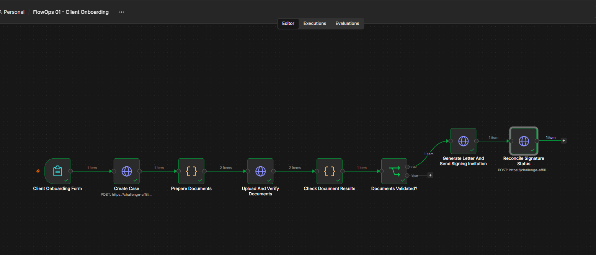
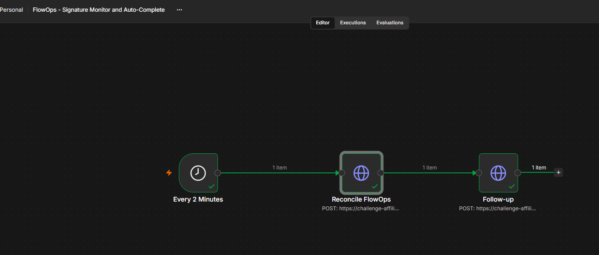
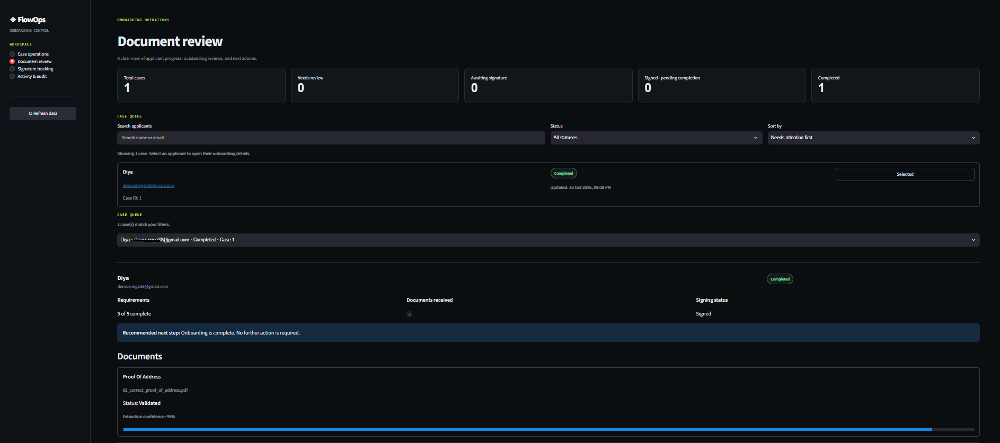

# FlowOps — Client Onboarding Automation

FlowOps automates the operational steps between receiving a client's onboarding documents and completing the onboarding process. It validates submitted information, tracks missing requirements, coordinates electronic signatures, and sends status notifications.

The main problem it addresses is fragmented onboarding: document checks, client follow-ups, signature tracking, and completion updates can otherwise require manual coordination across multiple tools.

## Screenshots

**Workflow 1 — Client Onboarding**



**Workflow 2 — Signature Monitoring & Auto-Completion**



## Architecture

```text
Client / Onboarding Request
            |
            v
     n8n Workflow 1
     Client Onboarding
            |
            v
       FastAPI Backend
            |
            v
   Document Processing
   - Text extraction
   - OCR where supported
   - Field extraction
   - Validation rules
            |
            v
       SQLite Database
   - Client cases
   - Documents
   - Requirements
   - Workflow events
   - Signature records
            |
      +-----+------+
      |            |
      v            v
 Gmail API    Streamlit UI
 Notifications  Case Review
      |
      v
Requirements satisfied?
      |
      v
Electronic Signature Request
      |
      v
     n8n Workflow 2
 Signature Monitoring
      |
      v
 Signing Provider
      |
      v
 Verify Signature Status
      |
      v
 Check Completion Conditions
      |
      v
 Mark Case Complete
      |
      v
 Final Client Notification
```

## Technology Stack

| Component | Technology | Purpose |
|---|---|---|
| Backend API | FastAPI | Handles API requests and onboarding operations |
| Data storage | SQLite | Persists cases, document results, requirements, events, and signature state |
| Workflow automation | n8n | Coordinates onboarding and signature-monitoring steps |
| Document processing | Python, pypdf, Tesseract OCR, Pillow | Extracts text and fields from supported documents |
| Email | Gmail API | Sends onboarding, correction, signature, and completion communications |
| E-signatures | Configurable signing integration | Creates and monitors signature requests |
| Dashboard | Streamlit, pandas | Displays onboarding cases and their current state |
| Investigation | Python, LangGraph | Runs a bounded, tool-based investigation using deterministic classification |

## Workflow 1 — Client Onboarding

This workflow handles the initial onboarding process, from receiving the request to preparing the case for signature.

1. **Receive onboarding information:** The workflow passes the client and document information to the backend.
2. **Create or update the case:** The backend stores the onboarding state and associates submitted documents with the case.
3. **Extract document fields:** Supported files are processed to retrieve relevant information, such as names, identification details, and addresses.
4. **Validate the extracted data:** Required fields are checked against document-specific rules. Name mismatches, missing fields, and uncertain extraction results are handled separately.
5. **Persist the results:** Document status, extracted fields, outstanding requirements, and workflow events are recorded in SQLite.
6. **Notify the client when action is needed:** Missing or incorrect information can trigger a correction request.
7. **Check readiness for signing:** The case progresses only when its required onboarding conditions are satisfied.

### Document validation outcomes

- **Validated:** Required fields satisfy the configured validation rules.
- **Needs correction:** Required information is missing or needs to be supplied again.
- **Needs review:** A mismatch, uncertain extraction, or other issue requires further review.

OCR and field extraction help automate checks, but they do not establish that an uploaded document is genuine.

## What Happens Before E-Signing?

A signature request should not be the first step after a document upload. The application must first establish that the onboarding requirements are satisfied.

Before requesting a signature, FlowOps checks the case's requirements and document statuses. If information is missing or requires correction, the case remains in the appropriate state and the client can be notified. Once the required conditions are met, the signing integration can initiate the electronic-signature process.

This separates document readiness from signature completion: a case that is ready for signing is not yet a completed case.

## Workflow 2 — Signature Monitoring & Auto-Completion

This workflow handles the stages after a signature request has been initiated.

1. **Track pending signatures:** Identify cases waiting for signature completion.
2. **Check the signing provider:** Retrieve the signature status through the configured integration.
3. **Handle pending or failed checks:** A pending signature remains pending. Integration failures must not be interpreted as successful signing.
4. **Record signature state:** Store the available provider status and verification information.
5. **Evaluate completion conditions:** Check the signature state alongside outstanding requirements and the application's completion policy.
6. **Complete the case only when eligible:** Sending an invitation or receiving an unverified status is not sufficient to mark onboarding complete.
7. **Send the final notification:** Once the completion conditions are satisfied, the application can send the client the completion communication and any permitted final documents.

The signing provider's capabilities determine how signature callbacks and verification are implemented. A successful API response alone does not establish legal validity.

## Failure Handling

FlowOps distinguishes business-process failures from integration failures.

- **Missing document information:** Request correction rather than progressing the case prematurely.
- **Name mismatch or uncertain extraction:** Route the document for review.
- **Signature still pending:** Keep the case awaiting signature.
- **Signing integration unavailable:** Preserve the pending state rather than treating the request as completed.
- **Unmet completion requirements:** Prevent final completion until the required conditions are satisfied.

## Dashboard

The Streamlit dashboard provides a view of onboarding cases and their document and workflow states. It supports operational review without requiring users to inspect raw database records or follow every workflow execution manually.



